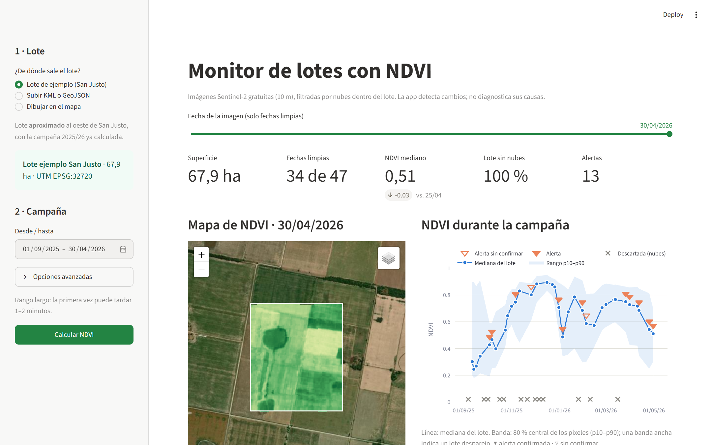
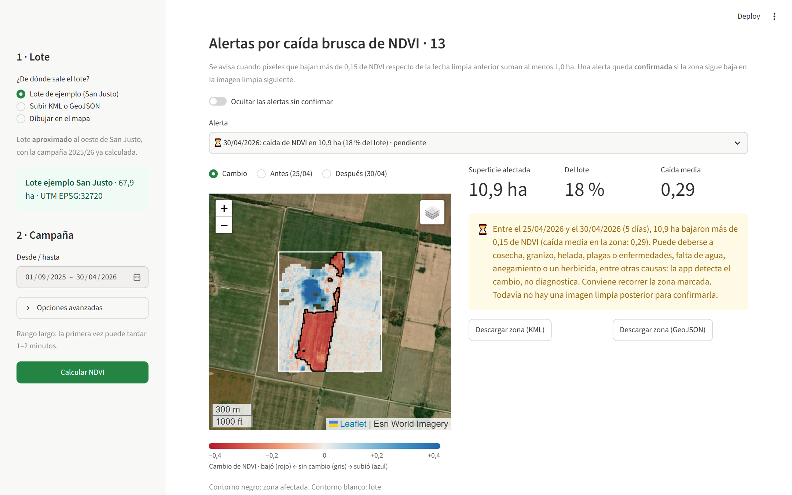
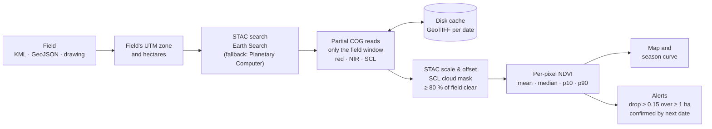

# Field monitor with NDVI (Sentinel-2)

[](https://github.com/IGNACIOBONGIOVANNI/monitor-lotes-ndvi/actions/workflows/ci.yml)
· [Versión en español](README.md)

A web app that tracks an agricultural field with **free** Sentinel-2 satellite imagery: it
computes NDVI for every cloud-free date, shows the map and the season curve, and **warns when
NDVI drops sharply in part of the field**, with a map of that zone and its area in hectares.

**🔗 Live demo:** _to be published on Streamlit Community Cloud_



> The interface is in Spanish (the target users are farmers and agronomists in Argentina).

## The problem

Nobody can walk every field every week. Farmers, agronomists and co-ops need to know **where
to look**: which field changed, and which part of it. Sentinel-2 images are free and arrive
every few days, but downloading them, removing clouds and comparing dates by hand takes time.
This app automates it for one field:

1. Load the field: a **Google Earth KML**, a **GeoJSON**, or **draw it on the map**.
2. The app searches the images for a date range, **discards cloudy dates by looking only at
   the field**, and computes NDVI.
3. It shows the field colored by NDVI with a date selector, plus the curve for the whole season.
4. If a zone drops more than 0.15 NDVI (configurable) over more than 1 ha (configurable), it
   raises an **alert** with a map of the zone, its area, and the zone as a downloadable **KML**
   (for Google Earth or a drone flight planner).

> The app **detects, it does not diagnose**: a drop can be harvest, hail, frost, pests, drought,
> waterlogging or a herbicide. Every alert says so and recommends scouting the zone.



## How it works



- **Data:** the `sentinel-2-c1-l2a` collection from the
  [Earth Search](https://earth-search.aws.element84.com/v1) STAC catalog (Element 84), with
  Microsoft Planetary Computer as a fallback.
- **Lightweight:** images are COGs (Cloud Optimized GeoTIFFs), so only the blocks covering the
  field are read (a few KB per date, not hundreds of MB). Downloads run in parallel: a full
  season takes about 1.5 minutes the first time and seconds afterwards, thanks to the cache.
- **Clouds:** the SCL band removes shadows, clouds, cirrus, snow, and no-data or saturated
  pixels. If less than 80 % of the field is clear (configurable), the date is skipped.
- **NDVI** = (NIR − Red) / (NIR + Red), applying each band's **scale and offset** from the STAC
  metadata (without the offset, crop NDVI comes out ~0.25 too low; a test demonstrates it).
- **Hectares:** computed in the field's UTM zone, derived from its location (not hard-coded).
- **Alerts:** pixel-by-pixel comparison with the previous clear date, an isolated-pixel filter,
  and confirmation with the next clear date.

Every technical decision, with the alternatives that were discarded, is documented (in Spanish)
in [docs/DECISIONES.md](docs/DECISIONES.md).

## Run it locally

Requires Python 3.11+ (tested with 3.13). No GPU needed.

```bash
git clone https://github.com/IGNACIOBONGIOVANNI/monitor-lotes-ndvi.git
cd monitor-lotes-ndvi
python -m venv .venv
.venv\Scripts\activate          # Linux/Mac: source .venv/bin/activate
pip install -r requirements.txt
streamlit run app.py
```

Command line, no UI:

```bash
python -m monitor_lotes.cli data/ejemplo/lote_ejemplo.kml --desde 2025-09-01 --hasta 2026-04-30
```

Tests and lint (no internet needed):

```bash
pip install pytest ruff
pytest
ruff check . && ruff format --check .
```

## Limitations

- **10 m resolution:** each pixel is 0.01 ha. Field edges mix inside and outside, and features
  smaller than ~20–30 m are not visible.
- **Clouds:** in rainy periods there can be weeks without a clear date. SCL does not always
  catch thin clouds, haze or cloud edges, which is why alerts are confirmed with the next date.
- **Days without images:** Sentinel-2 revisits every few days, not daily. After a long gap, a
  change may have happened at any point in that period (alerts mention gaps over 20 days).
- **NDVI saturates** over very dense canopies (above ~0.85).
- **The example field is approximate:** a rectangle near San Justo (Santa Fe, Argentina) that
  covers parts of several paddocks, hence its many alerts.
- On Streamlit Community Cloud the cache is cleared when the app restarts.

## Next steps

- **NDRE** (red edge) for dense crops where NDVI saturates, and **NDMI** for water stress.
- **Sentinel-1 radar** to keep monitoring through cloudy periods.
- **Management zones** from the NDVI history, exportable as variable-rate prescriptions
  (e.g. for spray drones).
- Multiple fields per user and **automatic notifications** (email or Telegram) on a schedule.
- Rainfall and temperature to give context to each drop.

## Data and credits

- Contains modified Copernicus Sentinel data (2025–2026), processed by ESA.
- Catalog: [Earth Search](https://element84.com/earth-search/) by Element 84 on AWS Open Data.
  Fallback: [Microsoft Planetary Computer](https://planetarycomputer.microsoft.com/).
- Basemap: Esri World Imagery (visual reference only).

---

Built by **Ignacio Bongiovanni** (San Justo, Santa Fe, Argentina) — IT and certified
agricultural drone operator (DJI Academy).
