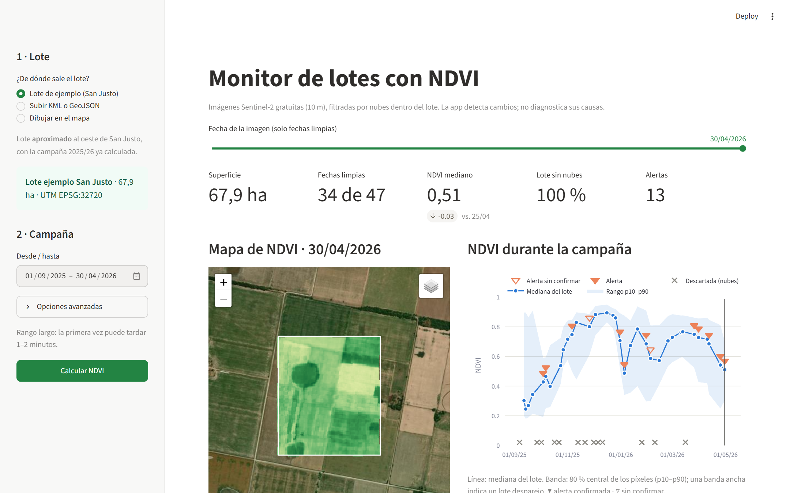
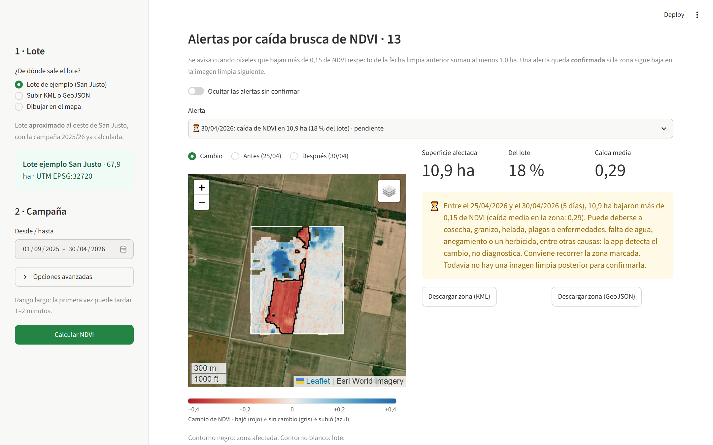
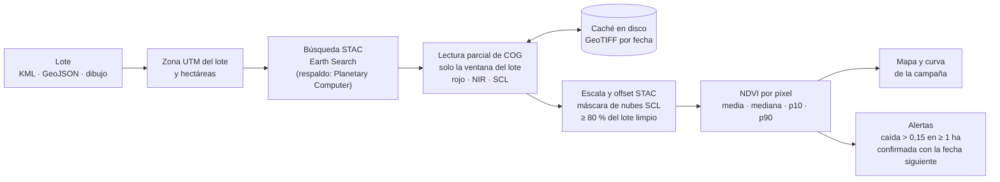

# Monitor de lotes con NDVI (Sentinel-2)

[](https://github.com/IGNACIOBONGIOVANNI/monitor-lotes-ndvi/actions/workflows/ci.yml)
· [English version](README.en.md)

App web que sigue la evolución de un lote agrícola con imágenes satelitales **gratuitas**
de Sentinel-2: calcula el NDVI de cada fecha sin nubes, muestra el mapa y la curva de la
campaña, y **avisa cuando el NDVI cae de golpe en una zona del lote**, con un mapa de la zona
y cuántas hectáreas son.

**🔗 Demo online: [monitor-lotes-ndvi.streamlit.app](https://monitor-lotes-ndvi.streamlit.app/)**
(abre con el lote de ejemplo ya calculado; si la app estuvo un tiempo sin uso, Streamlit
tarda unos segundos en despertarla)



## Qué problema resuelve

Recorrer todos los lotes todas las semanas no es posible. Un productor, un asesor o una
cooperativa necesitan saber **dónde mirar**: qué lote cambió y en qué parte. Las imágenes de
Sentinel-2 son gratuitas y pasan cada pocos días, pero bajarlas, sacar las nubes y compararlas
a mano lleva tiempo. Esta app lo automatiza para un lote:

1. Cargás el lote: un **KML de Google Earth**, un **GeoJSON** o lo **dibujás en el mapa**
   (polígono punto por punto o rectángulo que se puede **girar**; los dibujos se editan y se
   borran de a uno).
2. La app busca las imágenes del rango de fechas, **descarta las nubladas mirando solo el
   lote** y calcula el NDVI.
3. Muestra el lote coloreado por NDVI con selector de fecha, y la curva de toda la campaña.
4. Si una zona del lote baja más de 0,15 de NDVI (configurable) y suma más de 1 ha
   (configurable), genera una **alerta** con el mapa de la zona, las hectáreas y la zona
   descargable en **KML** (para Google Earth o el planificador de vuelo de un dron).

> La app **detecta, no diagnostica**: una caída puede ser cosecha, granizo, helada, plaga,
> falta de agua, anegamiento o un herbicida. El texto de cada alerta lo aclara y recomienda
> recorrer la zona.



## Cómo funciona



- **Datos:** colección `sentinel-2-c1-l2a` del catálogo STAC
  [Earth Search](https://earth-search.aws.element84.com/v1) (Element 84). Si no responde, se
  usa Microsoft Planetary Computer.
- **Liviano:** las imágenes son COG (Cloud Optimized GeoTIFF), así que de cada una se leen solo
  los bloques que cubren el lote (unos KB por fecha, no cientos de MB). Las descargas van en
  paralelo: una campaña completa tarda alrededor de 1,5 minutos la primera vez y segundos
  después, porque queda en caché.
- **Nubes:** con la banda SCL se descartan sombras, nubes, cirros, nieve y píxeles sin datos o
  saturados. Si queda limpio menos del 80 % del lote (configurable), esa fecha no se usa.
- **NDVI** = (NIR − Rojo) / (NIR + Rojo), con la **escala y el offset** que indica la metadata
  STAC de cada banda (sin el offset, el NDVI de un cultivo sale ~0,25 más bajo; hay un test
  que lo muestra).
- **Hectáreas:** se calculan en la zona UTM del lote, deducida de su posición (no fija).
- **Alertas:** comparación píxel a píxel con la fecha limpia anterior, filtro de píxeles
  sueltos y confirmación con la fecha limpia siguiente.

Cada decisión técnica, con las alternativas descartadas, está en
[docs/DECISIONES.md](docs/DECISIONES.md).

## Correrlo en local

Requiere Python 3.11 o más nuevo (probado con 3.13). No necesita placa de video.

```bash
git clone https://github.com/IGNACIOBONGIOVANNI/monitor-lotes-ndvi.git
cd monitor-lotes-ndvi
python -m venv .venv
.venv\Scripts\activate          # en Linux/Mac: source .venv/bin/activate
pip install -r requirements.txt
streamlit run app.py
```

Desde la terminal, sin interfaz:

```bash
python -m monitor_lotes.cli data/ejemplo/lote_ejemplo.kml --desde 2025-09-01 --hasta 2026-04-30
# opciones: --min-limpio 0.8  --caida 0.15  --min-ha 1  --salida carpeta/  --fuente planetary-computer
```

Tests y lint (no usan internet):

```bash
pip install pytest ruff
pytest
ruff check . && ruff format --check .
```

## Estructura

```
app.py                    interfaz Streamlit (sin lógica pesada)
src/monitor_lotes/
  lotes.py                lectura de KML/GeoJSON, zona UTM, hectáreas, exportar KML
  busqueda.py             búsqueda STAC y lectura recortada al lote
  ndvi.py                 escala/offset, máscara SCL, NDVI y estadísticas
  serie.py                serie temporal, descargas en paralelo, exportar/importar
  alertas.py              detección, confirmación y zona afectada
  cache.py                caché en disco (GeoTIFF con las bandas crudas)
  visual.py               colores, reproyección para el mapa y gráfico
  cli.py                  uso desde la terminal
tests/                    tests con arrays inventados (sin internet)
data/ejemplo/             lote de ejemplo y sus resultados ya calculados
docs/                     DECISIONES.md y capturas
```

## Limitaciones

- **Resolución de 10 m:** cada píxel es 0,01 ha. Los bordes del lote mezclan lo de adentro con
  lo de afuera, y no se ven detalles menores a unos 20–30 m (una mancha de malezas chica, una
  huella de máquina).
- **Nubes:** en épocas lluviosas puede haber semanas sin una fecha limpia. La SCL no detecta
  siempre las nubes finas, la bruma o los bordes de nubes; por eso las alertas se confirman
  con la fecha siguiente.
- **Días sin imagen:** Sentinel-2 pasa cada pocos días, pero no todos los días. Si entre dos
  fechas limpias hubo un hueco largo, el cambio pudo ocurrir en cualquier momento de ese
  período (la alerta lo avisa cuando pasan más de 20 días).
- **El NDVI se satura** en cultivos muy densos (por encima de ~0,85): ahí distingue poco entre
  "muy bien" y "excelente".
- **El lote de ejemplo es aproximado:** es un rectángulo cerca de San Justo (Santa Fe) que
  abarca partes de varios potreros, por eso tiene varias alertas.
- En Streamlit Community Cloud la caché se borra cuando la app se reinicia.

## Próximos pasos

- **NDRE** (borde rojo) para cultivos densos donde el NDVI se satura, y **NDMI** para estrés
  hídrico.
- **Radar Sentinel-1** para seguir el lote en épocas de nubes.
- **Zonas de manejo** a partir del historial de NDVI, exportables como prescripción para
  pulverización o fertilización variable (por ejemplo con drones).
- Varios lotes por usuario y **avisos automáticos** (correo o Telegram) con una tarea programada.
- Sumar lluvia y temperatura para dar contexto a cada caída.

## Datos y créditos

- Contiene datos modificados de Copernicus Sentinel (2025–2026), procesados por ESA.
- Catálogo: [Earth Search](https://element84.com/earth-search/) de Element 84, sobre AWS Open
  Data. Respaldo: [Microsoft Planetary Computer](https://planetarycomputer.microsoft.com/).
- Mapa base: Esri World Imagery (solo de referencia visual).

---

Hecho por **Ignacio Bongiovanni** (San Justo, Santa Fe) — IT y operador certificado de drones
agrícolas (DJI Academy).
